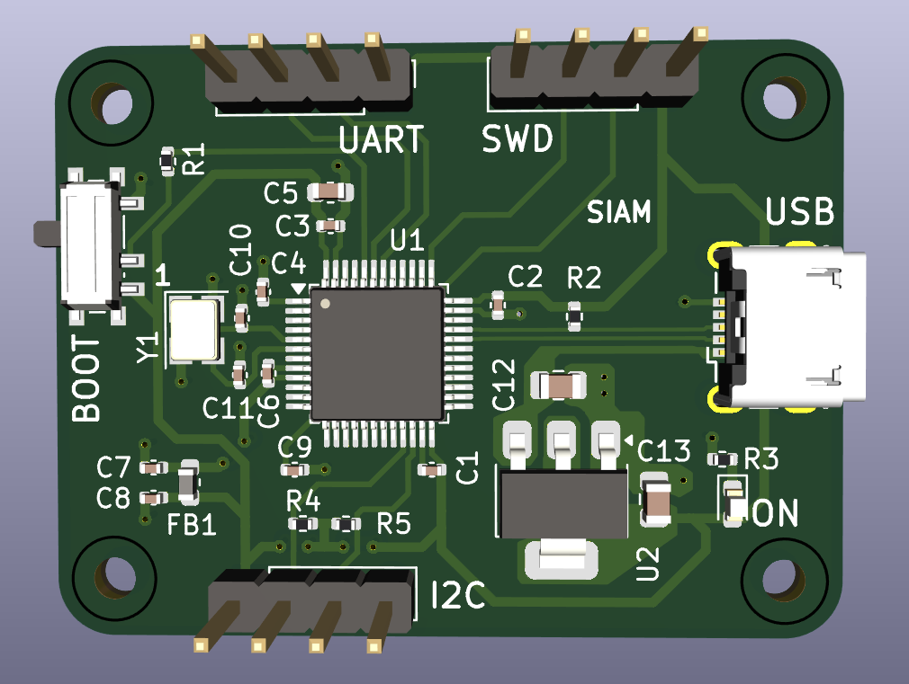
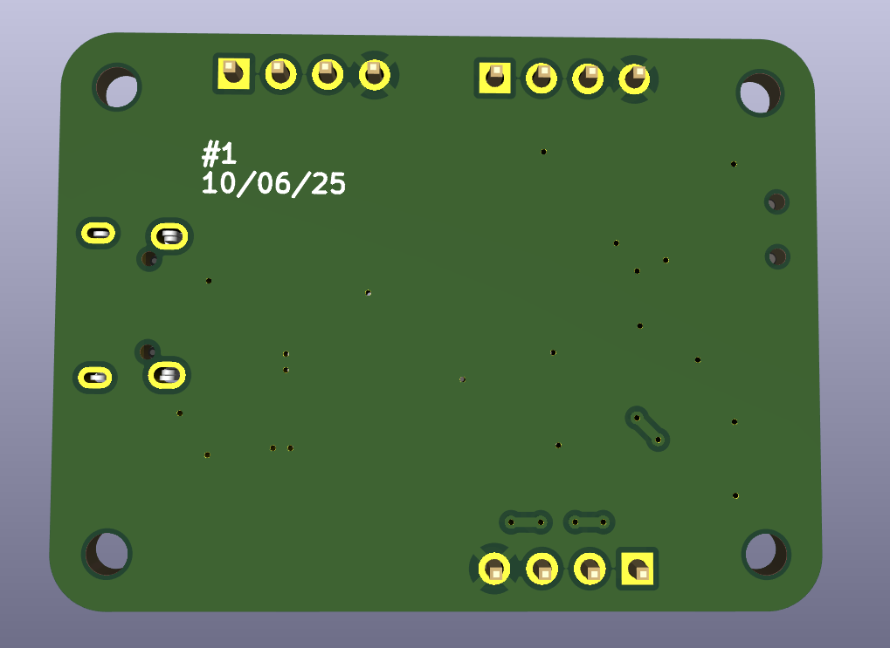
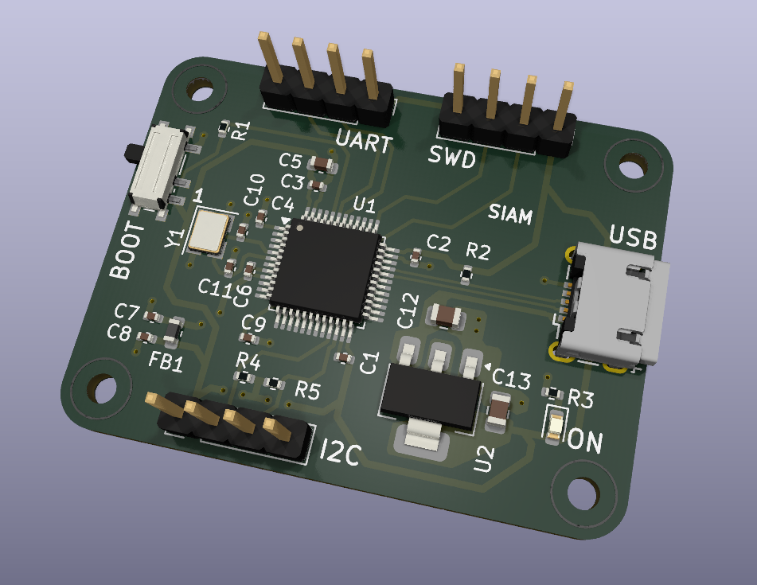

# Custom_STM32_Bluepill_PCB_Design
This project is a custom-designed 2-layer PCB based on the STM32 Blue Pill development board. The goal was to design a compact, reliable microcontroller board with proper power regulation and USB interface.

## What it has:
UART and I2C communication protocols are enabled. USB type-B is used in this board. Besides bootloader pins I have also included Serial Wire debbug.

## What I learned from this project:
2 Layered PCB Design, Basic communication protocols, Connection through polygon pores, Calculations for suitable capacitors specially in Oscillators, Power regulation, filtering through pi-filters, bulk capacitors and decoupling capacitors.

For schematics and pcb check the files 

## Images:
## Schematic View:
### LDO Configuration:

### Layout of STM32F103C8T6:

### PCB Design:

### Top View:

### Bottom View

### Angled View

