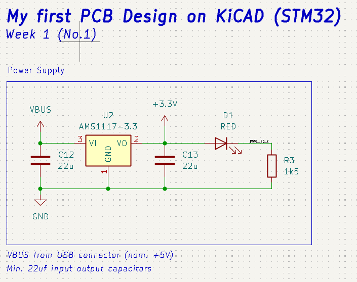
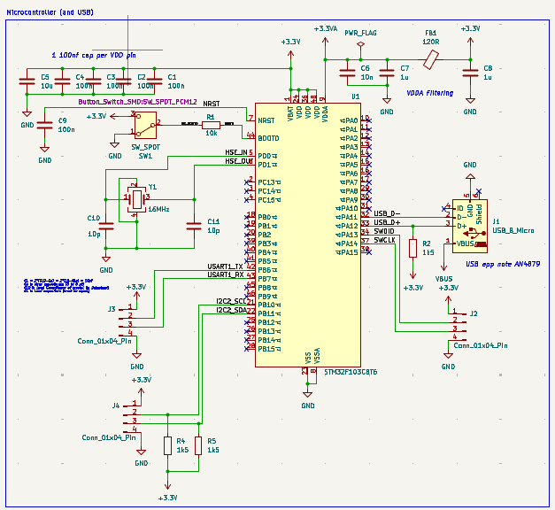
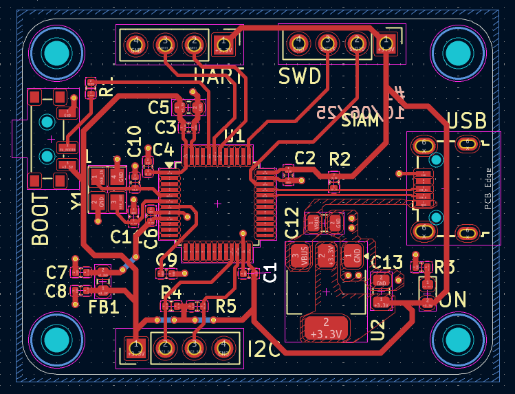

# Custom STM32 Development Board

This project is a custom-designed 2-layer PCB based on the STM32 Blue Pill development board. The goal was to build a compact and reliable microcontroller board with proper power regulation and a USB interface.

### Features
- UART and I²C communication interfaces.
- USB Type-B connector.
- Bootloader pins for programming and configuration.
- Serial Wire Debug (SWD) interface for debugging and programming.
- Power regulation and filtering circuits.

### Practical Applications
This board can serve as a general-purpose microcontroller platform for developing and testing embedded systems. It can be used to:
- Interface with sensors and modules through I²C and UART.
- Read sensor data and control external devices.
- Develop and test custom embedded firmware.
- Debug and troubleshoot microcontroller-based projects using SWD.
- Build the control unit for small electronics and automation projects.

### What I Learned
- Designing and routing 2-layer PCBs.
- Working with basic communication protocols such as UART and I²C.
- Using copper polygon pours for PCB connections.
- Selecting suitable capacitors especially for oscillator circuits.
- Understanding power regulation and filtering.
- Using PI filters with ferrite beads, bulk capacitors and decoupling capacitors.
- Designing PCB through KiCAD.

### Learning Reference
I learned the design process by following **Phil's Lab** on YouTube. I used his schematics and PCB design as a learning reference. I learned his routing techniques and design preferences then applied them while routing my own PCB and thus made my first PCB project on KiCAD.

For schematics and pcb check the files 

## Images:
## Schematic View:
### LDO Configuration:

### Layout of STM32F103C8T6:

### PCB Design:

### Top View:

### Bottom View

### Angled View

